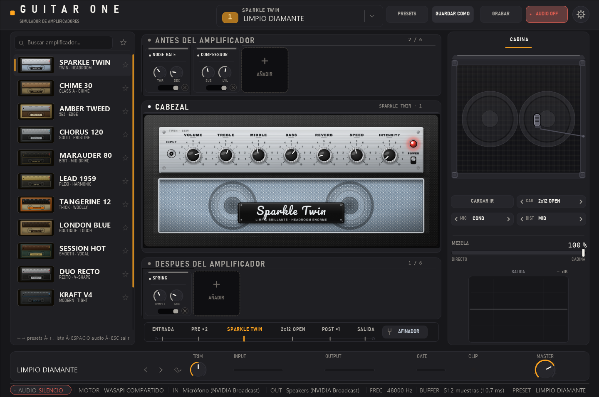
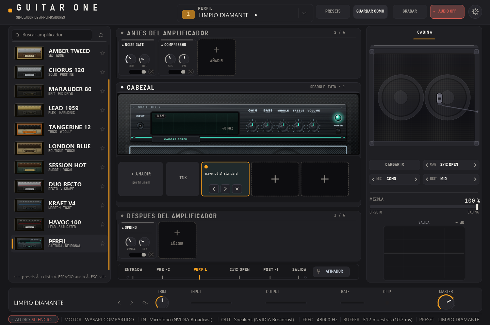
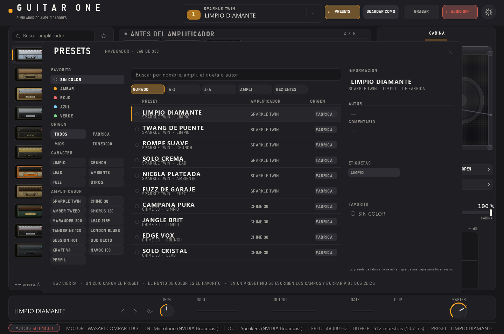
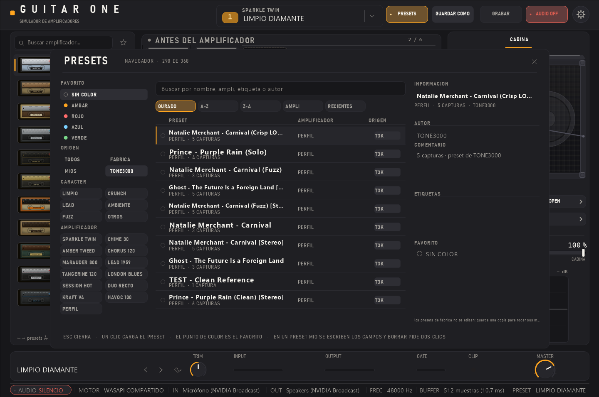
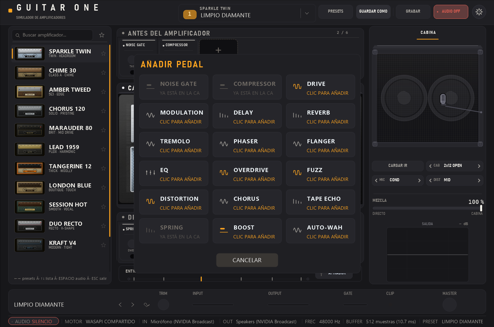
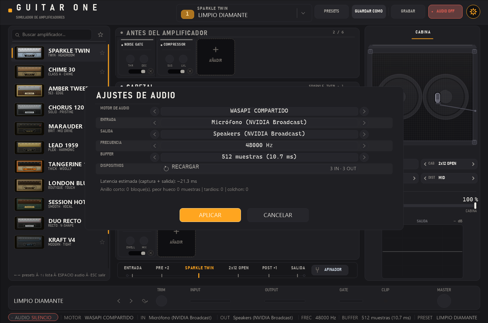
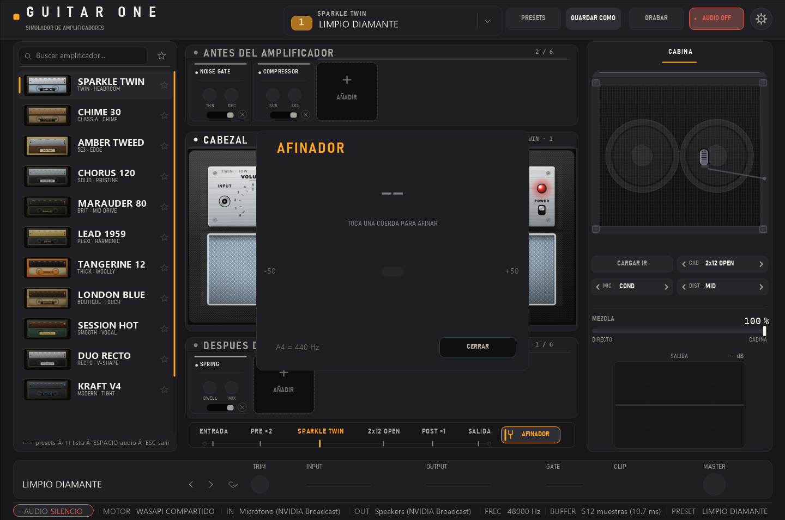

# GUITAR ONE

**Simulador de amplificadores de guitarra para Windows.** Aplicación **nativa**
(Win32 + GDI+): un solo `.exe`, sin frameworks, sin instalador y sin ninguna
dependencia que instalar. Trece cabezales —doce voces modeladas y un cabezal que
carga **capturas neuronales `.nam`**—, pedalboard de 18 tipos, cabina con
respuesta de impulso, afinador y grabación a WAV.


[](LICENSE)

[](https://github.com/dario90vlc/guitar-one/releases/latest)



---

## Qué es

Un rack de estudio en una ventana. El sonido entra por arriba (estante **antes del
amplificador**), pasa por el cabezal, sale por el estante **después del
amplificador** y termina en la banda de cadena, que resume el recorrido y guarda
el afinador. El orden del sonido se ve sin etiquetarlo, y cada unidad se lee
montada —banda de título, tornillos, filete— en vez de pegada al fondo.

El color grande lo pone el equipo: los frontales reales de los amplificadores
(dibujados en SVG y compilados a PNG), la tela de la cabina y las caras de los
pedales. El chrome es grafito plano y un único ámbar que solo aparece en lo que
suena o en lo que se puede tocar.

**No es un plugin VST3** y no necesita ningún host: es una aplicación que se abre
y suena.

## Capturas

| Cabezal con su frontal real | Cabezal PERFIL (capturas `.nam`) |
|---|---|
|  |  |

| Catálogo de presets | Tus presets de TONE3000 |
|---|---|
|  |  |

| Paleta de pedales | Ajustes de audio | Afinador |
|---|---|---|
|  |  |  |

*(Las capturas se generan con el propio binario: `_dsp_test.exe render <png>`
pinta la ventana completa con el mismo código de dibujo que usa la app, en una
ventana fuera de pantalla.)*

## Lo que trae

### Amplificadores

- **13 cabezales**: 12 voces modeladas (limpio, crunch y alta ganancia) con su
  frontal real, sus seis mandos propios y **6 presets de fábrica cada uno** (78 en
  total), más el cabezal **PERFIL**.
- Cada voz es un preamp de **dos etapas de tubo en cascada** con bias real,
  tone stack, presencia, bright cap, *sag* de potencia y resonancia de carga; el
  tramo no lineal va **sobremuestreado 4×** con filtro de diezmado real.
- **Nivel igualado entre voces** (±0,15 dB medidos): cambiar de amplificador no
  pega saltos de volumen.

### Cabezal PERFIL: capturas neuronales (NAM)

- Carga `.nam` del [Neural Amp Modeler](https://github.com/sdatkinson/NeuralAmpModelerCore)
  hechos por la comunidad, incluidos los **A2** que publica TONE3000.
- **Cadena de hasta 4 capturas** en serie, con encendido, nivel y orden (`<` `>`).
- **Explorador TONE3000** integrado (mismos 7 filtros de equipo que su web):
  tendencias públicas sin clave, descarga e inserción en la cadena, y tu
  biblioteca local de presets `*.t3kpreset`.
- La **frecuencia del fichero se respeta**: si la captura es de 48 kHz y el motor
  va a 44,1, se convierte antes y después del modelo (interpolador polifásico).

### Pedalboard y cabina

- **18 tipos de pedal** en dos filas (antes y después del ampli), con arrastre
  para reordenar y para cruzar el cabezal. Todos con nivel compensado.
- **Cabina**: 6 modelos procedurales + **IR de usuario desde WAV** (PCM 8/16/24/32
  y float 32/64, mono o estéreo), 3 micrófonos × 3 distancias y **MEZCLA**
  directo/cabina, con convolución overlap-save.

### Lo demás

- **Presets**: 78 de fábrica + los tuyos (guardar, renombrar, borrar, color de
  favorito) + los de tu cuenta de TONE3000, **todos en la misma lista** con
  filtros por etiqueta, amplificador y origen, buscador y orden.
- **Afinador cromático** modal, **grabación a WAV**, visualizador y medidores.
- **Ajustes de audio**: WASAPI compartido o exclusivo, 44,1–192 kHz, buffer
  128–4096, selección de dispositivos y botón para **recargar los recién
  conectados** sin reiniciar.
- Interfaz redimensionable, con escala según DPI, y paleta de teclado.

## Requisitos

- **Windows 10 u 11 de 64 bits.**
- Nada más: el `.exe` enlaza únicamente DLLs del sistema (`ole32`, `user32`,
  `gdi32`, `gdiplus`, `comdlg32`, `dwmapi`, `winhttp`, `crypt32`, `shell32`,
  `avrt`, `kernel32`). **No** hace falta VC++ Redistributable, ni .NET, ni
  instalar nada.
- Tarjeta de sonido con WASAPI (cualquier interfaz USB sirve). No hay ASIO.

## Descargar y ejecutar

1. Descarga el [ZIP de la última release](https://github.com/dario90vlc/guitar-one/releases/latest)
   y descomprímelo donde quieras.
2. Doble clic en **`GuitarAmp.exe`**.
3. Pulsa **AUDIO ON** en la cabecera: la app arranca en silencio a propósito.

La carpeta `amps_frontales\` tiene que ir al lado del `.exe` (son los frontales).
Si falta, la app funciona igual pero con caras dibujadas por código.

**Los perfiles son de sus autores.** Las capturas `.nam` y los presets de
TONE3000 **no se incluyen**: se descargan de su web desde el explorador integrado
(botón **T3K**) o se añaden desde disco.

## Compilar

Solo hace falta **Visual Studio 2022 Build Tools** con el **Windows SDK**
(`cl` compila y `rc` mete el icono y la ficha de versión). Nada más: no hay
dependencias que descargar, ni CMake, ni vcpkg.

```powershell
git clone https://github.com/dario90vlc/guitar-one
cd guitar-one
.\_build.ps1                 # app: rc + cl /utf-8 /O2 /EHsc /std:c++17 + firma local si hay certificado
.\native\_build_dsp.ps1      # banco de medida del DSP (sin UI ni audio)
```

`_build.ps1` deja `native\GuitarAmp.exe`. Para generar el paquete de release
(`dist\GuitarAmp-<ver>-win64\` + ZIP, con el `.exe` y los 26 PNG que carga):

```powershell
.\_mkdist.ps1 -Version 1.0.0
```

## Uso rápido

| Gesto | Qué hace |
|---|---|
| Clic en un amplificador de la lista | Cambia de cabezal (con sus presets) |
| `←` `→` | Preset anterior / siguiente |
| `↑` `↓` | Mueve la lista de la izquierda |
| Rueda sobre la torre | Reordena el pedal bajo el cursor |
| **PRESETS** | Catálogo: fábrica, míos y los de tu TONE3000 |
| **+ AÑADIR** de un estante | Paleta de pedales |
| **T3K** del cabezal PERFIL | Explorador de TONE3000 |
| Arrastrar un mando | 1 px = 0,4 % del recorrido (SHIFT: ajuste fino) |
| Doble clic en un mando | Vuelve al valor con el que se cargó |
| ESPACIO | Enciende o apaga el audio |
| ESC | Cierra el modal abierto |

